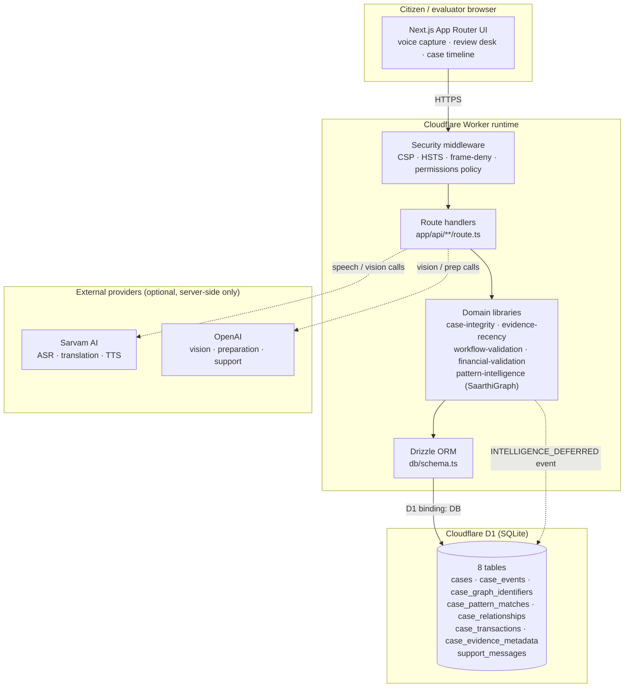

# CyberSaarthi

**A self-contained cyber-fraud reporting and evidence-verification system for Indian citizens.**

Developed by **Sandeep Hipparagi**.

CyberSaarthi turns a frightened, code-switched, voice-first complaint into a
structured, deduplicated, evidence-backed case record that a citizen can carry to
the National Cyber Crime Reporting Portal (NCRP / 1930). It runs as a single
Next.js application on Cloudflare Workers, stores everything in Cloudflare D1
through Drizzle ORM, and treats every citizen-facing record as synthetic unless a
deployment explicitly says otherwise.

---

## Table of contents

1. [Why this exists](#why-this-exists)
2. [System architecture](#system-architecture)
3. [Request lifecycle](#request-lifecycle)
4. [Data model (Drizzle ORM)](#data-model-drizzle-orm)
5. [Case integrity gate](#case-integrity-gate)
6. [Evidence verification pipeline](#evidence-verification-pipeline)
7. [Deferred intelligence queue](#deferred-intelligence-queue)
8. [API surface](#api-surface)
9. [Security posture](#security-posture)
10. [Local setup](#local-setup)
11. [Database migrations](#database-migrations)
12. [Testing](#testing)
13. [Deployment](#deployment)
14. [Demo accounts](#demo-accounts)
15. [Data and privacy statement](#data-and-privacy-statement)
16. [Repository layout](#repository-layout)
17. [License](#license)

---

## Why this exists

A financial cyber-fraud victim in India has roughly two hours to act. The money
moves through mule accounts within minutes, and the 1930 helpline can only freeze
it if the complaint arrives with the right facts: exact transaction reference
(UTR), precise time, amount, recipient identifier, and the channel. Most victims
arrive with a voice note, a screenshot, a regional-language narrative, and no
idea which of those details matter.

CyberSaarthi closes that gap in four moves:

- **Capture in the citizen's own language and voice** - speech recognition,
  translation, and structured field extraction run before the citizen has to type
  anything in English.
- **Verify what the evidence actually says** - OCR timestamps are parsed in IST
  with timezone-safe arithmetic and classified into golden-hour windows, so the
  system never overstates urgency it cannot prove.
- **Refuse to fabricate** - an integrity gate blocks submission until required
  facts are present, marks every missing field explicitly, and keeps synthetic
  fixtures distinguishable from live records at the schema level.
- **Hand over something usable** - a deduplicated case record, a timeline, an
  NCRP routing suggestion, and a financial workflow summary.

---

## System architecture



Everything above runs in one deployable unit. There is no separate queue server,
no message broker, and no second database: the asynchronous work queue is
event-sourced inside `case_events`, and the Worker is the only execution runtime.

### ASCII request flow

```
citizen browser
   │  POST /api/cases  (narrative + facts + evidence refs)
   ▼
security middleware  ── CSP, HSTS, X-Frame-Options, Permissions-Policy
   ▼
route handler        ── session check (signed cookie, role: CITIZEN | EVALUATOR)
   ▼
integrity gate       ── allowed provider? required facts present? dedupe fingerprint?
   ▼
Drizzle transaction  ── cases ─ case_events ─ case_transactions ─ case_evidence_metadata
   ▼
SaarthiGraph index   ── case_graph_identifiers ─ case_pattern_matches ─ case_relationships
   │                     └─ on failure: INTELLIGENCE_DEFERRED event, retried on next read
   ▼
response             ── caseId, demo reference, submission readiness
```

---

## Request lifecycle

1. **Capture.** `/api/asr` accepts recorded audio, validates the container, and
   transcribes through Sarvam ASR (`saaras:v3`). `/api/prepare` and
   `/api/prepare-fields` translate the narrative and extract candidate fields
   (UTR, amount, timestamp, recipient identifier, channel) into a typed draft.
2. **Evidence analysis.** `/api/evidence/analyse` sends attached images to a
   vision model, extracts text, and parses any timestamp it finds.
3. **Verification.** `lib/evidence-recency.ts` converts the parsed timestamp to
   IST with explicit offset arithmetic, rejects impossible and future dates, and
   classifies the evidence into a golden-hour window.
4. **Submission.** `/api/cases` runs the integrity gate, computes a dedupe
   fingerprint, writes the case, its events, its financial rows and its evidence
   metadata, then attempts graph indexing.
5. **Review.** The review desk reads `/api/cases` and `/api/workflows/*`, showing
   submission readiness, missing fields, and the case timeline.

---

## Data model (Drizzle ORM)

The schema lives in [`db/schema.ts`](db/schema.ts) and targets SQLite via
`drizzle-orm/sqlite-core`, which is what Cloudflare D1 speaks. Eight tables:

| Table | Purpose | Notable constraints |
|---|---|---|
| `cases` | One row per citizen complaint: narratives (native + English), language, provider, route, district, loss amount, status, urgency, extracted facts and unknowns | `uniqueIndex(owner_email, dedupe_fingerprint)` prevents the same incident being filed twice by one owner; `synthetic` defaults to `true` |
| `case_events` | Append-only event log per case (submission, acknowledgement, repeat fixture, `INTELLIGENCE_DEFERRED`) | Indexed by case; carries actor role and JSON metadata |
| `case_graph_identifiers` | Fingerprinted identifiers (UPI ID, account number, phone) extracted from case facts | `uniqueIndex(case_id, identifier_type, fingerprint)`; indexed by type + fingerprint for cross-case linking |
| `case_pattern_matches` | Fraud-pattern hypotheses with confidence in basis points and reviewer status | `uniqueIndex(case_id, pattern_code)`; `status` defaults to `PROPOSED` |
| `case_relationships` | Edges between cases discovered by the graph index | Indexed by case |
| `case_transactions` | Normalised financial rows (UTR, amount, timestamp, recipient) | Indexed by case |
| `case_evidence_metadata` | Provenance for every attached artefact: media type, storage path, checksum, source image | `uniqueIndex(case_id, evidence_id, source_image_id)`; `checksum` indexed for duplicate-evidence detection |
| `support_messages` | Conversational support thread with the citizen | Indexed by case |

Design choices worth noting for review:

- **Deduplication is enforced by the database, not by application logic.** The
  fingerprint is computed from the incident, and the unique index is the final
  arbiter - two concurrent submissions cannot both succeed.
- **Synthetic status is a column, not a convention.** `cases.synthetic` and
  `case_evidence_metadata.synthetic` default to `true`, so a deployment has to
  actively opt out of the synthetic guarantee.
- **Identifiers are fingerprinted, never stored raw in the graph tables**, which
  keeps cross-case correlation possible without duplicating plaintext PII across
  tables.

---

## Case integrity gate

`lib/case-integrity.ts` is the policy layer between the citizen and the database.

- **Provider allow-list.** `ALLOWED_CASE_PROVIDERS` enumerates the only accepted
  origins (`CITIZEN_TYPED`, `CYBERSAARTHI_GUIDED_VOICE`, `SARVAM_AI`,
  `DETERMINISTIC_DEMO`, `SYNTHETIC_AUTO_LANGUAGE_FIXTURE`, and related fixtures).
  Anything that looks like scraping or harvesting is rejected by pattern, so a
  new provider string cannot silently widen the boundary.
- **Submission readiness.** Each case returns an explicit checklist with three
  ownership classes - `Citizen`, `AI + citizen`, and `Prototype boundary` - and
  an outcome of `READY` or `GAPS_REMAIN`. Missing fields are surfaced as missing,
  never filled in with plausible guesses.
- **Transaction-reference extraction** normalises
  `financial.transactionReference`, `transaction.reference` and `transaction.utr`
  into canonical alphanumeric UTRs before any verification or dedupe step runs.

---

## Evidence verification pipeline

The pipeline exists to answer one question honestly: *does this evidence prove
the money moved within the golden hour?*

```
image ──▶ vision extraction ──▶ raw timestamp string
                                      │
                                      ▼
                        lib/evidence-recency.ts
                        · parse against an explicit month table
                        · convert to IST with a fixed +330 minute offset
                        · validate that the components round-trip (no rollover)
                        · reject timestamps more than 5 minutes in the future
                                      │
                                      ▼
                    window: UNDER_2H | OVER_2H | UNKNOWN
                    reason: WITHIN_TWO_HOURS | OUTSIDE_TWO_HOURS |
                            NO_TIMESTAMP | UNREADABLE_TIMESTAMP | FUTURE_TIMESTAMP
                                      │
                                      ▼
                    case_evidence_metadata + case_events
                    (checksum, media type, storage path, source image id)
```

Three properties matter here:

1. **Timezone safety is explicit.** Timestamps are treated as IST with a fixed
   offset rather than the host's locale, so a Worker running in any region
   produces identical assessments. The round-trip validation rejects dates that
   would silently roll over (for example 31 February).
2. **`UNKNOWN` is a first-class outcome.** An unreadable or absent timestamp
   never degrades into "assume urgent" or "assume fine" - it is reported as
   unverifiable with a specific reason.
3. **Every artefact carries a checksum.** Duplicate uploads of the same evidence
   are detectable by the indexed `checksum` rather than by filename.

---

## Deferred intelligence queue

Graph indexing is the expensive, failure-prone step; case recording is the
critical path. The system separates them with an event-sourced queue:

```
write case ──▶ try indexCaseIntelligence()
                 │
                 ├── success ──▶ case_graph_identifiers, case_pattern_matches,
                 │                case_relationships written
                 │
                 └── failure ──▶ case_events row: INTELLIGENCE_DEFERRED
                                  "Relationship analysis queued"
                                  actor: SYSTEM / SaarthiGraph
                                  metadata: { officialOutcome: false }
                                  ──▶ retried deterministically on the next
                                      case-list read
```

The citizen's case is never lost because enrichment failed, and the queue state is
observable: a `INTELLIGENCE_DEFERRED` event is durable evidence that a retry is
owed, and it survives Worker restarts because it is a database row rather than
in-memory state. Pattern scoring in `lib/pattern-intelligence.ts` is deterministic
and version-stamped (`engine_version`, `intelligence_version`) so a retry produces
the same result as the original attempt.

---

## API surface

| Route | Method | Purpose |
|---|---|---|
| `/api/asr` | POST | Speech-to-text for a recorded complaint |
| `/api/tts` | POST | Text-to-speech narration of guidance |
| `/api/voice-agent` | POST | Guided voice agent turn |
| `/api/prepare` | POST | Narrative translation and field preparation |
| `/api/prepare-fields` | POST | Structured field extraction |
| `/api/evidence/analyse` | POST | Vision extraction and timestamp parsing |
| `/api/cases` | GET / POST | List cases / submit a case through the integrity gate |
| `/api/cases/action` | POST | Reviewer action on a case |
| `/api/workflows/financial` | GET | Financial workflow summary |
| `/api/workflows/timeline` | GET | Case timeline reconstruction |
| `/api/workflows/status` | GET | Workflow status |
| `/api/auth/login` · `logout` · `session` | POST / POST / GET | Signed-cookie session |
| `/api/auth/judge-session` | POST | Demo evaluator session |
| `/api/demo-records` · `/api/demo/reset` | GET / POST | Synthetic fixture management |

---

## Security posture

- **Transport and browser hardening** are applied in the Worker entry point, not
  per route: a strict `Content-Security-Policy` (no inline scripts beyond the
  hashed app bundle, `object-src 'none'`, `frame-ancestors 'none'`),
  `Strict-Transport-Security` for one year with subdomains, `X-Frame-Options:
  DENY`, `X-Content-Type-Options: nosniff`, `Referrer-Policy: strict-origin`, and
  a `Permissions-Policy` that permits the microphone and nothing else.
- **Sessions** are signed cookies with an explicit expiry and a role claim; the
  signing secret comes from `AUTH_SESSION_SECRET` and is never in source.
- **Passwords** for demo accounts are stored as salted SHA-256 digests, compared
  in constant time.
- **Secrets are server-side only.** No provider key is ever sent to the browser;
  every external call originates in a route handler.
- **No database URL exists to leak.** The application talks to D1 through a
  binding, so there is no connection string in configuration or environment.
- **Graph correlation uses HMAC fingerprints** keyed by `GRAPH_HMAC_SECRET`, so
  identifier tables cannot be reversed into plaintext UPI IDs or account numbers
  without the key.

---

## Local setup

### Prerequisites

- Node.js **22.13.0 or newer** (`node --version`)
- npm 10+
- A Cloudflare account only if you intend to deploy; local development runs D1
  in-process

### 1. Install

```bash
git clone https://github.com/Sandeep-Hipparagi/cybersaarthi.git
cd cybersaarthi
npm ci
```

### 2. Configure environment

```bash
cp .env.example .env.local
```

Generate the two secrets rather than inventing them:

```bash
node -e "console.log(crypto.randomUUID().replace(/-/g,'') + crypto.randomUUID().replace(/-/g,''))"
```

Set `AUTH_SESSION_SECRET` and `GRAPH_HMAC_SECRET` to two different values. The
provider keys (`SARVAM_API_KEY`, `OPENAI_API_KEY`) are optional: without them the
speech, translation and vision routes degrade to their deterministic fixture
paths, which is enough to run the full review flow offline.

### 3. Apply the schema

```bash
npm run db:generate     # regenerate SQL migrations from db/schema.ts
npx wrangler d1 migrations apply DB --local
```

`wrangler` reads the migrations directory from the D1 binding configuration; it
must point at `drizzle/`, which is where `drizzle-kit` writes. For a fresh local
database this creates all eight tables from `drizzle/0000`-`0003`.

### 4. Run

```bash
npm run dev             # Vite + Wrangler dev server with the D1 binding
```

Open the printed local URL. The review desk loads with synthetic fixtures; no
provider key is required to see the end-to-end flow.

### 5. Build

```bash
npm run build           # bounded production build, writes dist/server
```

---

## Database migrations

Migrations are generated from `db/schema.ts` by `drizzle-kit` and committed as
plain SQL under `drizzle/`, with snapshots in `drizzle/meta/`.

```bash
npm run db:generate                      # create a new migration after editing the schema
npx drizzle-kit generate                 # equivalent direct invocation
npx wrangler d1 migrations apply DB --local    # apply to the local D1 database
npx wrangler d1 migrations apply DB --remote   # apply to the deployed database
```

Rules for contributors:

- Never edit an applied migration. Add a new one.
- `drizzle/meta/_journal.json` must list every migration file; CI fails if a
  migration exists without a journal entry or vice versa.
- Every table declared in `db/schema.ts` must appear in at least one migration;
  CI enforces this so a schema change cannot ship without SQL.

Current migration set:

| Migration | Contents |
|---|---|
| `0000_lame_black_cat.sql` | Base case, event and support tables |
| `0001_light_thor.sql` | Initial index adjustments |
| `0002_lowly_wendell_vaughn.sql` | Graph, pattern and relationship tables |
| `0003_pink_madrox.sql` | Transaction and evidence metadata tables |

---

## Testing

The suite uses the Node built-in test runner - no test framework dependency.

```bash
npm test                                                  # full: build + all suites
node --experimental-strip-types --test tests/workflow-validation.test.mjs
node --experimental-strip-types --test tests/evidence-recency.test.mjs
node --experimental-strip-types --test tests/voice-recording.test.mjs
node --test tests/api-workflows.test.mjs                  # needs dist/server from a build
node --test tests/rendered-html.test.mjs
```

| Suite | Covers |
|---|---|
| `workflow-validation.test.mjs` | UTR normalisation, acknowledgement format, chronology, golden-hour assessment, description sanitisation |
| `evidence-recency.test.mjs` | IST timestamp parsing, rollover rejection, future-clock tolerance, window classification |
| `api-workflows.test.mjs` | End-to-end route behaviour against a real D1 binding and the built Worker |
| `rendered-html.test.mjs` | Server-rendered page output and absence of development metadata |
| `voice-recording.test.mjs` | Audio container detection and normalisation |
| `workflow-validation.test.mjs` | Financial draft merging and audio validation |

CI runs type-checking, the migration integrity check, the pure-library suites and
a production build on every push to `main`.

---

## Deployment

The application targets Cloudflare Workers with a D1 binding named `DB`.

1. Create the database: `npx wrangler d1 create cybersaarthi`
2. Point the D1 binding in the Worker configuration at that database, with
   `migrations_dir = "drizzle"`.
3. Apply migrations: `npx wrangler d1 migrations apply DB --remote`
4. Set secrets: `npx wrangler secret put AUTH_SESSION_SECRET` (and
   `GRAPH_HMAC_SECRET`, plus any provider keys you want enabled).
5. Deploy: `npx wrangler deploy`

A Vercel target is also configured (`npm run build:vercel`) for environments
without Workers, but the D1 binding is the supported production path.

---

## Demo accounts

The deployed demo ships with two accounts so evaluators can see both sides of the
review desk. **These are demo credentials and they are intentionally public.**

| Role | Email | Password |
|---|---|---|
| Citizen | `citizen@test.com` | `test2026` |
| Evaluator | `evaluator@cybersaarthi.demo` | `JudgeDemo2026!` |

If you deploy this for anything other than a demonstration, replace both accounts,
change `AUTH_SESSION_SECRET`, and set `SEED_DEMO_USERS=false`-equivalent
behaviour by removing the fixture seeding from your deployment. The accounts grant
access to synthetic records only; there is no production data path in this
repository.

---

## Data and privacy statement

- Every record created by the demo, the tests and the fixtures is **synthetic**.
  `cases.synthetic` and `case_evidence_metadata.synthetic` default to `true`.
- Synthetic fixtures are labelled in source as `source: "Synthetic fixture"`. The
  identifiers in them (UPI handles, transaction references, acknowledgement
  numbers) are invented and do not correspond to real accounts or real people.
- No real citizen data, no real Aadhaar number, and no real bank account number is
  present in this repository or in its history.
- If you fork this for a real deployment: you are handling sensitive personal data
  under India's DPDP Act 2023. Encrypt at rest, restrict access to the review desk,
  define a retention period, and log every access to a case record.

---

## Repository layout

```
app/                     Next.js App Router: UI (page.tsx, layout.tsx) and 18 route handlers
  api/                   asr, tts, voice-agent, prepare, evidence, cases, workflows, auth, demo
db/
  schema.ts              Drizzle schema - the eight tables above
  index.ts               D1 binding accessor and Drizzle client
drizzle/                 Generated SQL migrations + snapshots
lib/
  case-integrity.ts      Provider allow-list, submission readiness, UTR extraction
  case-store.ts          Case persistence, dedupe, event log, deferred indexing
  evidence-recency.ts    IST timestamp parsing and golden-hour classification
  evidence-contract.ts   Evidence shape and validation
  workflow-validation.ts UTR, acknowledgement, chronology, golden-hour helpers
  financial-validation.ts, ncrp-routing.ts, pattern-intelligence.ts,
  narration-field-extraction.ts, demo-auth.ts, demo-response.ts,
  emergency-triage.ts, language-support.ts, support-assistant.ts,
  audio-validation.ts, voice-recording.ts, api-response.ts
worker/index.ts          Worker entry: security headers, asset and image handling
tests/                   Six node:test suites
scripts/                 Build and environment helpers
public/                  Brand assets
```

---

## License

Apache License 2.0 - see [LICENSE](LICENSE).

Developed by **Sandeep Hipparagi** (https://www.bluepatterns.ai/).

CyberSaarthi is an independent citizen-facing prototype. It is not affiliated
with, endorsed by, or operated by the Government of India, NCRP, or any police
department. Helpline references are provided for citizen convenience only.
